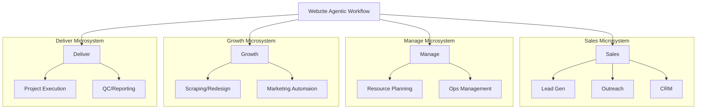

# Webzite Agentic Workflow: System Core Rules

This document serves as the master blueprint for the Webzite Agentic Workflow. It defines the architecture, directory structure, and operational standards for all agentic processes.

> [!IMPORTANT]
> **Documentation Integrity Rule**: Whenever a change is made to the technical implementation of this system, the corresponding markdown files **MUST** be updated immediately to maintain synchronization between documentation and code.

> [!IMPORTANT]
> [AGENTS.md](./AGENTS.md), [CLAUDE.md](./CLAUDE.md), and [GEMINI.md](./GEMINI.md) must stay identical. These filenames exist separately because different agent runtimes auto-load different entry-point names.

## 0. Infrastructure
This system is designed to run on a **Hostinger VPS** with the following specifications:
- **OS**: Ubuntu 24.04 LTS
- **Execution Environment**: All Python executors and system-level tools must be compatible with this Linux distribution.

> [!IMPORTANT]
> **Mandatory Section**: Every Markdown file created within this system **MUST** include an Infrastructure section at the end of the file to ensure environment compatibility.

> [!IMPORTANT]
> **Mandatory Section**: Every Markdown file created within this system **MUST** include a Version Control section (before Infrastructure) referencing the root-level version control rules. This ensures every workflow and pillar document reinforces Git discipline for agents operating in that context.

## 1. System Architecture

The system is organized into four primary pillars (Microsystems), each responsible for a specific stage of the business lifecycle.



## 2. Directory Structure & Microsystems

The root contains shared infrastructure (`mcp-servers/`) and four standalone Microsystems (pillars). The `mcp-servers/` directory sits above all microsystems as cross-cutting infrastructure — any pillar can reference its MCP servers.

| Component | Directory | Purpose |
| :--- | :--- | :--- |
| **MCP Infrastructure** | `mcp-servers/` | Shared MCP server index, setup docs, and config — above all microsystems. |
| **Sales** | `sales/` | Lead acquisition, Upwork scraping, CRM management, and proposal automation. |
| **Manage** | `manage/` | Internal operations, documentation, **Global Assets Hub**, and financial maintenance. |
| **Growth** | `growth/` | Dynamic prospecting, rapid prototyping (Vercel), and design comparisons. |
| **Deliver** | `deliver/` | Client project execution, SEO optimization, and final handoffs. |

### 2.1 Workflow Folder Structure
Every workflow within a pillar must follow this structure:
- `[workflow-name]/`: The root folder for the process.
- `[workflow-name].md`: **The Directive**. Contains the logic, prompts, and requirements.
- `[workflow-name].py`: **The Executor**. The Python script that triggers the logic.
- `.tmp/`: **Artifact Storage**. Stores workflow-owned intermediate and output files (HTML, CSVs, scraped data, manifests, logs, and lightweight generated artifacts). `.tmp/` folders are included in Git so workflow state and text artifacts travel with the repository. Heavy binary/media assets inside `.tmp/` remain excluded by file type and are synced to the VPS via `rclone`.

### 2.2 MCP Server Folder Structure
Every MCP server registered in the project follows this structure under `mcp-servers/`:
- `[mcp-name]/`: Subfolder for each MCP server (e.g., `webflow/`, `figma/`).
- `setup.md`: Setup, authorization, and usage documentation.
- `MCP_INDEX.md`: Master index of all MCP servers in the project.
- `ACCESS_MODEL.md`: Folder-based MCP access procedure shared by all pillars.
- `profiles/`: Reusable MCP access profiles (agency, client, prospect, design, deployment).

### 2.3 Folder-Based MCP Access
MCP server definitions stay centralized in `.mcp.json` and `mcp-servers/`, but MCP usage is controlled by the active folder's nearest `mcp-access.md`.

Before using any MCP tool, agents must:
1. Identify the active folder context.
2. Read the closest applicable `mcp-access.md`.
3. Read the referenced profile in `mcp-servers/profiles/`.
4. Confirm the intended MCP server is listed in [mcp-servers/MCP_INDEX.md](./mcp-servers/MCP_INDEX.md).
5. Verify runtime authentication through `/mcp`, `claude mcp list`, or the active MCP client's equivalent status check.
6. Confirm the target account, site, project, repository, base, deployment, or other resource before changing it.
7. Ask explicit confirmation before publishing, deleting, overwriting, billing, emailing, deploying, changing production data, or using private session data.
8. Store MCP outputs in the active workflow's `.tmp/` folder unless the workflow specifies another repo-safe path.

Folders that rely on MCPs must include an `mcp-access.md` file documenting allowed MCPs, target resources, allowed operations, forbidden operations, confirmation requirements, runtime authentication notes, and artifact paths. Client projects use `deliver/[client-name]/docs/mcp-access.md`.

## 3. Global Operational Standards

- **Context Filtering**: When working on a specific workflow, agents should prioritize the `.md` file within that workflow folder to save tokens and maintain focus.
- **Directive Improvement Loop**: At the end of each task, agents must update the specific directive `.md` files they used to learn or execute that process whenever the task reveals a missing step, changed requirement, new decision, corrected assumption, or reusable process improvement. This applies even when no code changes were made. Keep updates scoped to the relevant workflow, pillar, MCP, or root directive, and preserve the mirrored entry-point files when they are affected.
- **Environment Variables**: All API keys and secrets are shared globally via a root `.env` file.
- **MCP Servers**: MCP servers are defined in `.mcp.json` (project scope) and documented in `mcp-servers/`. OAuth-based MCPs (e.g., Webflow, Figma) authenticate at runtime — no static tokens required. Usage is controlled by the folder-based procedure in [mcp-servers/ACCESS_MODEL.md](./mcp-servers/ACCESS_MODEL.md).
- **Inter-system Connectivity**: Microsystems connect through Python executors. Output from a `sales` workflow can trigger a `growth` or `deliver` process.
- **Safety**: No destructive actions (deleting client data, unapproved publishing) should be taken without explicit confirmation in the directive.

## 4. Version Control & Asset Management

This system is version-controlled via a **GitHub repository**. All contributors and agents must follow these rules.

**Architecture: Git for code, docs, and lightweight workflow artifacts; rclone for heavy binary assets. Both directions are supported.**
```
Local PC ──── git push (code/docs) ──────────→ GitHub ──→ VPS (git pull via GitHub Actions)
VPS      ──── git push (agent artifacts) ────→ GitHub ──→ Local (git pull)

Local PC ──── rclone sync --direction push ──→ VPS  (local assets → VPS)
Local PC ←─── rclone sync --direction pull ──  VPS  (VPS-generated assets → local)
Local PC ←──→ rclone bisync ─────────────────→ VPS  (merge both sides)
```

- **Resume work from anywhere — one command (local)**: `bash scripts/sync.sh` is the canonical way to bring both workspaces into sync in both directions. Run on the local machine, it: fetches and integrates remote git work **before** pushing local work (never auto-clobbering), pushes (triggering the VPS auto-deploy), and runs a safe `rclone bisync` for assets. Preview with `--dry-run`; the first-ever bisync needs `--resync`. The directional `sync-assets.sh` commands below remain the lower-level primitives. See [HERMES.md](./HERMES.md) and §4.5.
- **Automatic VPS deploys**: Pushes to `main` trigger the GitHub Actions workflow in `.github/workflows/deploy-vps.yml`, which SSHes into the VPS and runs a guarded `git pull --ff-only origin main`. Setup details and required GitHub secrets are documented in [DEPLOYMENT.md](./DEPLOYMENT.md).
- **VPS → GitHub pushes**: When a VPS agent (e.g., [Hermes](./HERMES.md)) produces git-tracked artifacts, run `bash scripts/vps-commit-push.sh` on the VPS to commit and push to GitHub (it pulls before pushing so it never clobbers). Receive them locally with `bash scripts/sync.sh` (git + assets) or a plain `git pull` for git-tracked files only.

### 4.1 Repository Hygiene
- **Platform**: GitHub (private repository).
- **`.gitignore`**: Enforced at the repo root. The following are **never committed**:
  - `.env` and any files containing API keys or secrets.
  - OS/IDE junk files (`__pycache__/`, `.DS_Store`, `Thumbs.db`, `.vscode/`, etc.).
  - Dependency folders, browser profile caches, and local test output (`node_modules/`, `**/pw-profile/`, `test-results/`, etc.).
  - **All binary/media files** (`*.png`, `*.jpg`, `*.jpeg`, `*.gif`, `*.webp`, `*.svg`, `*.ico`, `*.pdf`, `*.mp4`, `*.webm`, `*.mov`, `*.zip`, `*.7z`, `*.psd`, `*.ai`, `*.eps`, `*.fig`, `*.sketch`).
- **`.gitattributes`**: Enforced at the repo root. Scripts and source files that may run on the Ubuntu VPS must keep LF line endings so Windows checkouts do not break shell execution.
- **`.tmp/` folders**: Committed when they contain lightweight workflow state, text artifacts, HTML/CSS/JS, CSV/JSON, or other repo-friendly files. Heavy binary/media files inside `.tmp/` are still blocked by `.gitignore` and must not be force-added.
- **Commit Discipline**: Commits must be atomic and descriptive. One logical change per commit.

### 4.2 Asset Management (VPS Storage)
Heavy binary and media assets are **never** stored in Git. The **Hostinger VPS (100 GB)** is the single source of truth for those assets.

- **Global Brand Assets** (`manage/brand-assets/`): The canonical source for all agency brand materials. These files live on the VPS and are synced from the local machine via `rclone` (SFTP).
- **Deliver Project Files** (`deliver/[client-name]/workflows/[workflow-name]/.tmp/`): Initial client-provided source material lives once in `deliver/[client-name]/workflows/00-client-delivery-initialization/.tmp/client-handoff/`. Later workflow inputs, generated media, extracted assets, design prototypes, and final assets live in the `.tmp/` folder of the workflow that receives, produces, or uses them. Repo-friendly files in these paths are committed; heavy binary/media files are synced to the VPS.
- **Workflow Artifacts** (`.tmp/` folders): Generated at runtime and **not disposable**. Commit lightweight artifacts that are useful for review, replay, handoff, or agent continuity. Sync heavy binary/media outputs to the VPS via `rclone`, mirroring the same directory structure.
- **Sync commands** — use `scripts/sync-assets.sh` (wraps rclone with the correct filters):
  ```bash
  # Local → VPS (default; after working locally)
  bash scripts/sync-assets.sh --direction push

  # VPS → Local (after VPS agent generates assets)
  bash scripts/sync-assets.sh --direction pull

  # Bidirectional merge (first run requires --resync)
  bash scripts/sync-assets.sh --direction bisync --resync   # first time
  bash scripts/sync-assets.sh --direction bisync            # subsequent runs
  ```
  Configure the `vps` remote in `~/.config/rclone/rclone.conf` with SFTP credentials. See [DEPLOYMENT.md § Asset Sync](./DEPLOYMENT.md) for the full workflow.

- **Retired VPS paths**: When a repo restructure makes an old VPS-only path obsolete, first migrate any assets that still belong in the system, then add the retired path to `scripts/deploy-cleanup.sh`. Deployment cleanup must stay allowlisted and explicit; do not use broad `git clean -fdx` cleanup because valid ignored media intentionally lives on the VPS.

#### 4.2.1 Worktree → main asset mirror (automatic)

Excluding media from Git is load-bearing in three places, so the rule does not bend: it keeps merges
clean, keeps the VPS `git pull` lean, and keeps the deploy's clean-tree gate
(`test -z "$(git status --porcelain)"` in `.github/workflows/deploy-vps.yml`) passing — ignored files
do not appear in `git status`, tracked ones would. **Un-ignoring assets would break the deploy.**

The cost is that `git merge bk-<client>` brings the markup into `main` but not the images it
references, so a design opened from `main` renders broken. Since every worktree lives on one machine
and shares one `.git`, that gap is closed by a local copy — **not** by rclone, which is strictly the
local↔VPS channel:

```bash
bash scripts/mirror-assets.sh                 # scopes derived from HEAD's paths
bash scripts/mirror-assets.sh --all --dry-run # full sweep, preview only
bash scripts/mirror-assets.sh --to-worktree   # reverse: main -> this worktree
bash scripts/mirror-assets.sh --prune-dry-run # list orphans; never deletes
```

**A new worktree starts with zero assets.** `git worktree add` checks out tracked files only, so a
fresh worktree gets the markup and none of the images — designs open broken there exactly as they
did in `main`. `scripts/hooks/post-checkout` seeds it automatically: on a *new* worktree only
(previous HEAD is the null SHA), it infers the client folder from the branch name (`bk-` stripped,
then progressively shorter prefixes, so `bk-mason-park-2` still resolves to `mason-park`) and copies
that client's assets from `main`. It seeds one client rather than everything because `--all` means
~771 MB of scrapes and reference libraries the branch will never open. If the branch name matches no
client, the hook prints the exact command to run instead of guessing.

The mirror covers **vendored libraries as well as media**. Designs load GSAP from
`.tmp/_vendor/gsap/*.min.js`, which is ignored and is not a media extension; mirroring images but
not those yields a page that renders and never moves — a worse failure than a broken image, because
it still looks correct in a screenshot. Matching is path-anchored (`_vendor/`, `vendor/`) so
`node_modules` cannot be swept in.

This runs **automatically after every commit in every worktree** via `scripts/hooks/post-commit`,
wired up by `git config core.hooksPath <main>/scripts/hooks` (set by `scripts/bootstrap.sh`, and
required once per clone). Notes that matter:

- The hooks path is **absolute** by design. Worktrees share one config, but a *relative* hooksPath
  resolves against each worktree's own root, so a `bk-*` worktree on a branch predating
  `scripts/hooks/` would silently run no hook. For the same reason the hook resolves
  `mirror-assets.sh` from the **main** worktree, never the calling one.
- The mirror is **additive** — it never deletes in the destination. An asset deleted in a worktree
  lingers in `main`; find those with `--prune-dry-run` and remove them by hand.
- The hook always exits 0. `post-commit` cannot undo a commit anyway, and a failed asset copy must
  never surface as an error that derails the agent mid-task.
- Set `WEBZITE_SKIP_ASSET_MIRROR=1` for scripted bulk commits that would otherwise rescan the same
  folders once per commit.

### 4.3 Branching Strategy
- **`main`**: Production-ready state of the system. Protected — no direct pushes.
- **`dev`**: Active development and integration branch.
- **Feature branches**: Named `pillar/description` (e.g., `sales/upwork-scraper`, `manage/brand-refresh`). Merged into `dev` via pull request.

### 4.4 Agent Responsibilities
- Agents must **never** commit secrets or binary/media files. `.tmp/` folders are commit-eligible for lightweight workflow artifacts, but ignored heavy assets inside them must stay out of Git.
- When an agent creates or modifies a binary asset intended to persist, it must be placed in the appropriate asset path on disk: `manage/brand-assets/` for agency brand assets, or the owning Deliver workflow's `.tmp/` folder for client project assets. The user will sync it between local and VPS via `scripts/sync-assets.sh`.
- Agents should not force-push or rewrite shared branch history without explicit user confirmation.

### 4.5 Workspace Authority & Conflict Policy
The system has **two workspaces that can both change repo state**: the local machine (IDE / Claude desktop) and the VPS (where [Hermes](./HERMES.md) runs). This policy keeps them from clobbering each other.

- **GitHub `main` is the single source of truth for git-tracked state.** Neither workspace is inherently more authoritative — whoever pushes first wins the fast-forward, and the other must integrate remote work before pushing.
- **The VPS is the single source of truth for heavy binary/media assets** (restates §4.2). Local mirrors them via `rclone bisync`, which keeps both copies as `..conflict` files on a clash rather than overwriting.
- **Conflict resolution order**: (1) integrate remote git first, (2) resolve any git conflicts manually — never auto-clobber, (3) only then move assets.
- **Default safety**: `scripts/sync.sh` defaults to abort-on-divergence and `rclone bisync`. The destructive `--direction push`/`pull` mirrors in `sync-assets.sh` remain available but are opt-in/advanced.
- **Concurrency**: do not run `vps-commit-push.sh` on the VPS and `sync.sh` on local at the same time. If a push is rejected because the other side pushed first, simply re-run the safe command.
- **Hermes**: when committing inside this repo, Hermes must use `scripts/vps-commit-push.sh` (which pulls before pushing) and must never force-push or rewrite shared history.

## 5. Session Rotation — hand off at 200k tokens

**A session that reaches 200,000 tokens of context does not continue. It hands off to a fresh session through a runbook.** This applies to every agent in this system, in every worktree.

### Why a handoff and not a resume

Context is paid for on **every** turn, not once. A 200k-token session spends 200k on its next reply, and on the one after that, no matter how small the actual question is. Resuming such a session inherits that cost permanently; compacting it keeps a lossy summary of the whole history whether or not it is still relevant.

A runbook costs a few thousand tokens, once. Measured on this repo: a full handoff was **~1.6k tokens** against a **200k** resume. The ratio, not the absolute number, is the reason for the rule.

The trade is real and worth stating: a fresh session genuinely forgets things the runbook does not record. That is why the runbook is mandatory and why **Gotchas** is its most important section — failed approaches and environment quirks are exactly what a new session would otherwise pay to rediscover.

### The runbook

`.claude/RUNBOOK.md` at the worktree root. Untracked by design (see `.gitignore`): every worktree writes the same path, so tracking it would guarantee a merge conflict on every client branch. The durable record of what a session did is its **commits**; the runbook is only the bridge between sessions.

Two halves:

| Half | Owner | Content |
| :--- | :--- | :--- |
| `AUTO:BEGIN`…`AUTO:END` | `session-guard.mjs` | Branch, HEAD, recent commits, uncommitted files, context size. Regenerated on every write, so it cannot drift. |
| Everything below | **The agent** | Objective, Done (with SHAs), In progress, Next, Gotchas, Open questions. |

**Update the runbook after each completed task**, not only at the threshold. A runbook written under duress at 200k is written by an agent with no room left to write it well.

### How it is enforced

Two hooks, registered in the project's `.claude/settings.json`. They **merge with** the user-level hooks in `~/.claude/settings.json`, which belong to Orca — never move these there.

| Threshold | Behaviour |
| :--- | :--- |
| < 150k | Silent. |
| ≥ 150k | `Stop` hook nudges the agent to keep the runbook current. Non-blocking; at most one nudge per 20 minutes. |
| ≥ 200k | `Stop` hook **blocks the stop** (`decision: "block"`) until the tree is committed and the runbook is current. Then it rotates the terminal into a fresh session. |

Blocking is deliberate. A soft reminder at the threshold is ignored precisely when it matters, because the agent is mid-task and its next action always looks more urgent than writing a handoff. Making the handoff the only exit is what turns the rule into a guarantee.

`SessionStart` then injects the runbook into the new session automatically, so the rotation needs no human in the loop.

### Safety properties

- **Never rotates a dirty tree.** Uncommitted work is the one thing a handoff cannot carry, so the guard blocks and demands a commit instead.
- **Never rotates on a stale runbook.** Older than 45 minutes counts as stale.
- **Never wedges a session.** Every internal failure exits 0 silently; a broken guard is worse than no guard.
- **Rotation is a no-op if Orca is unavailable.** The runbook is already written, so the worst case is a manual restart, never lost work.
- **Relaunches on the same profile.** `session-rotate.mjs` reads `CLAUDE_CONFIG_DIR` so a client worktree comes back on `team`, not `personal` — otherwise the new session would silently hold different MCP grants.

### Files

| Path | Role |
| :--- | :--- |
| `scripts/session-lib.mjs` | Token measurement, git state, runbook template |
| `scripts/session-guard.mjs` | `Stop` hook — the ladder above |
| `scripts/session-resume.mjs` | `SessionStart` hook — injects the runbook |
| `scripts/session-rotate.mjs` | Closes and relaunches the Orca terminal |

Thresholds are overridable for tuning without editing code: `WEBZITE_CONTEXT_LIMIT`, `WEBZITE_CONTEXT_WARN`.

Context size is read from the transcript's recorded usage — `input + cache_creation + cache_read + output` of the **last** non-sidechain assistant message. The cache fields are the bulk of it, so counting `input_tokens` alone under-reports by roughly 100×. It reads the last message rather than the peak, because a compact genuinely shrinks the window and a peak-based measure would leave a compacted session permanently above the threshold.

## 6. Key Directives
- **Agent Hermes & Two-Workspace Sync**: [HERMES.md](./HERMES.md) — how Telegram-driven VPS work and local work stay in sync via `scripts/sync.sh`.
- **New Computer Install**: [INSTALL.md](./INSTALL.md) - restore this system on a new local workstation from GitHub, the VPS, and private credentials.
- **Pricing & Timeline Rules**: [PRICING_TIMELINE_RULES.md](./sales/PRICING_TIMELINE_RULES.md) — canonical per-page rates and execution duration. Single source of truth for Sales quoting, Deliver scheduling, and Manage invoicing.
- **Sales Rules**: [SALES_SYSTEM_RULES.md](./sales/SALES_SYSTEM_RULES.md)
- **Manage Rules**: [MANAGE_SYSTEM_RULES.md](./manage/MANAGE_SYSTEM_RULES.md)
- **Growth Rules**: [GROWTH_SYSTEM_RULES.md](./growth/GROWTH_SYSTEM_RULES.md)
- **Deliver Rules**: [DELIVER_SYSTEM_RULES.md](./deliver/DELIVER_SYSTEM_RULES.md)
