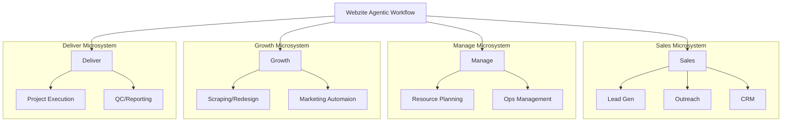

# Webzite Agentic Workflow: System Core Rules

This document serves as the master blueprint for the Webzite Agentic Workflow. It defines the architecture, directory structure, and operational standards for all agentic processes.

> [!IMPORTANT]
> **Documentation Integrity Rule**: Whenever a change is made to the technical implementation of this system, the corresponding markdown files **MUST** be updated immediately to maintain synchronization between documentation and code.

> [!IMPORTANT]
> [AGENTS.md](./AGENTS.md), [CLAUDE.md](./CLAUDE.md), and [GEMINI.md](./GEMINI.md) must stay identical. These filenames exist separately because different agent runtimes auto-load different entry-point names.

## 0. Infrastructure
This system is designed to run on a **Hostinger VPS** with the following specifications:
- **OS**: Ubuntu 24.04 LTS
- **Execution Environment**: All Python executors and system-level tools must be compatible with this Linux distribution.

> [!IMPORTANT]
> **Mandatory Section**: Every Markdown file created within this system **MUST** include an Infrastructure section at the end of the file to ensure environment compatibility.

> [!IMPORTANT]
> **Mandatory Section**: Every Markdown file created within this system **MUST** include a Version Control section (before Infrastructure) referencing the root-level version control rules. This ensures every workflow and pillar document reinforces Git discipline for agents operating in that context.

## 1. System Architecture

The system is organized into four primary pillars (Microsystems), each responsible for a specific stage of the business lifecycle.



## 2. Directory Structure & Microsystems

The root contains shared infrastructure (`mcp-servers/`) and four standalone Microsystems (pillars). The `mcp-servers/` directory sits above all microsystems as cross-cutting infrastructure — any pillar can reference its MCP servers.

| Component | Directory | Purpose |
| :--- | :--- | :--- |
| **MCP Infrastructure** | `mcp-servers/` | Shared MCP server index, setup docs, and config — above all microsystems. |
| **Sales** | `sales/` | Lead acquisition, Upwork scraping, CRM management, and proposal automation. |
| **Manage** | `manage/` | Internal operations, documentation, **Global Assets Hub**, and financial maintenance. |
| **Growth** | `growth/` | Dynamic prospecting, rapid prototyping (Vercel), and design comparisons. |
| **Deliver** | `deliver/` | Client project execution, SEO optimization, and final handoffs. |

### 2.1 Workflow Folder Structure
Every workflow within a pillar must follow this structure:
- `[workflow-name]/`: The root folder for the process.
- `[workflow-name].md`: **The Directive**. Contains the logic, prompts, and requirements.
- `[workflow-name].py`: **The Executor**. The Python script that triggers the logic.
- `.tmp/`: **Artifact Storage**. Stores workflow-owned intermediate and output files (HTML, CSVs, scraped data, manifests, logs, and lightweight generated artifacts). `.tmp/` folders are included in Git so workflow state and text artifacts travel with the repository. Heavy binary/media assets inside `.tmp/` remain excluded by file type and are synced to the VPS via `rclone`.

### 2.2 MCP Server Folder Structure
Every MCP server registered in the project follows this structure under `mcp-servers/`:
- `[mcp-name]/`: Subfolder for each MCP server (e.g., `webflow/`, `figma/`).
- `setup.md`: Setup, authorization, and usage documentation.
- `MCP_INDEX.md`: Master index of all MCP servers in the project.
- `ACCESS_MODEL.md`: Folder-based MCP access procedure shared by all pillars.
- `profiles/`: Reusable MCP access profiles (agency, client, prospect, design, deployment).

### 2.3 Folder-Based MCP Access
MCP server definitions stay centralized in `.mcp.json` and `mcp-servers/`, but MCP usage is controlled by the active folder's nearest `mcp-access.md`.

Before using any MCP tool, agents must:
1. Identify the active folder context.
2. Read the closest applicable `mcp-access.md`.
3. Read the referenced profile in `mcp-servers/profiles/`.
4. Confirm the intended MCP server is listed in [mcp-servers/MCP_INDEX.md](./mcp-servers/MCP_INDEX.md).
5. Verify runtime authentication through `/mcp`, `claude mcp list`, or the active MCP client's equivalent status check.
6. Confirm the target account, site, project, repository, base, deployment, or other resource before changing it.
7. Ask explicit confirmation before publishing, deleting, overwriting, billing, emailing, deploying, changing production data, or using private session data.
8. Store MCP outputs in the active workflow's `.tmp/` folder unless the workflow specifies another repo-safe path.

Folders that rely on MCPs must include an `mcp-access.md` file documenting allowed MCPs, target resources, allowed operations, forbidden operations, confirmation requirements, runtime authentication notes, and artifact paths. Client projects use `deliver/[client-name]/docs/mcp-access.md`.

## 3. Global Operational Standards

- **Context Filtering**: When working on a specific workflow, agents should prioritize the `.md` file within that workflow folder to save tokens and maintain focus.
- **Directive Improvement Loop**: At the end of each task, agents must update the specific directive `.md` files they used to learn or execute that process whenever the task reveals a missing step, changed requirement, new decision, corrected assumption, or reusable process improvement. This applies even when no code changes were made. Keep updates scoped to the relevant workflow, pillar, MCP, or root directive, and preserve the mirrored entry-point files when they are affected.
- **Copy Standards — no em dashes**: No em dash (`—`, `&mdash;`) may appear in any copy this system produces: client sites, proposals, emails, decks, any deliverable. Use a comma, colon, semicolon or full stop, chosen per instance — a blanket substitution leaves half of them ungrammatical. The rule covers every rendered string, including `alt`, `placeholder`, `title`, SEO and Open Graph descriptions, and JSON-LD. It does **not** cover code comments and developer notes, which are not copy. Verify on the **built** output with comments and `<script>`/`<style>` blocks stripped first, or the check reads its own notes back as failures.
- **Environment Variables**: All API keys and secrets are shared globally via a root `.env` file.
- **MCP Servers**: MCP servers are defined in `.mcp.json` (project scope) and documented in `mcp-servers/`. OAuth-based MCPs (e.g., Webflow, Figma) authenticate at runtime — no static tokens required. Usage is controlled by the folder-based procedure in [mcp-servers/ACCESS_MODEL.md](./mcp-servers/ACCESS_MODEL.md).
- **Inter-system Connectivity**: Microsystems connect through Python executors. Output from a `sales` workflow can trigger a `growth` or `deliver` process.
- **Safety**: No destructive actions (deleting client data, unapproved publishing) should be taken without explicit confirmation in the directive.

## 4. Version Control & Asset Management

This system is version-controlled via a **GitHub repository**. All contributors and agents must follow these rules.

**Architecture: Git for code, docs, and lightweight workflow artifacts; rclone for heavy binary assets. Both directions are supported.**
```
Local PC ──── git push (code/docs) ──────────→ GitHub ──→ VPS (git pull via GitHub Actions)
VPS      ──── git push (agent artifacts) ────→ GitHub ──→ Local (git pull)

Local PC ──── rclone sync --direction push ──→ VPS  (local assets → VPS)
Local PC ←─── rclone sync --direction pull ──  VPS  (VPS-generated assets → local)
Local PC ←──→ rclone bisync ─────────────────→ VPS  (merge both sides)
```

- **Resume work from anywhere — one command (local)**: `bash scripts/sync.sh` is the canonical way to bring both workspaces into sync in both directions. Run on the local machine, it: fetches and integrates remote git work **before** pushing local work (never auto-clobbering), pushes (triggering the VPS auto-deploy), and runs a safe `rclone bisync` for assets. Preview with `--dry-run`; the first-ever bisync needs `--resync`. The directional `sync-assets.sh` commands below remain the lower-level primitives. See [HERMES.md](./HERMES.md) and §4.5.
- **Automatic VPS deploys**: Pushes to `main` trigger the GitHub Actions workflow in `.github/workflows/deploy-vps.yml`, which SSHes into the VPS and runs a guarded `git pull --ff-only origin main`. Setup details and required GitHub secrets are documented in [DEPLOYMENT.md](./DEPLOYMENT.md).
- **VPS → GitHub pushes**: When a VPS agent (e.g., [Hermes](./HERMES.md)) produces git-tracked artifacts, run `bash scripts/vps-commit-push.sh` on the VPS to commit and push to GitHub (it pulls before pushing so it never clobbers). Receive them locally with `bash scripts/sync.sh` (git + assets) or a plain `git pull` for git-tracked files only.

### 4.1 Repository Hygiene
- **Platform**: GitHub (private repository).
- **`.gitignore`**: Enforced at the repo root. The following are **never committed**:
  - `.env` and any files containing API keys or secrets.
  - OS/IDE junk files (`__pycache__/`, `.DS_Store`, `Thumbs.db`, `.vscode/`, etc.).
  - Dependency folders, browser profile caches, and local test output (`node_modules/`, `**/pw-profile/`, `test-results/`, etc.).
  - **All binary/media files** (`*.png`, `*.jpg`, `*.jpeg`, `*.gif`, `*.webp`, `*.svg`, `*.ico`, `*.pdf`, `*.mp4`, `*.webm`, `*.mov`, `*.zip`, `*.7z`, `*.psd`, `*.ai`, `*.eps`, `*.fig`, `*.sketch`).
- **`.gitattributes`**: Enforced at the repo root. Scripts and source files that may run on the Ubuntu VPS must keep LF line endings so Windows checkouts do not break shell execution.
- **`.tmp/` folders**: Committed when they contain lightweight workflow state, text artifacts, HTML/CSS/JS, CSV/JSON, or other repo-friendly files. Heavy binary/media files inside `.tmp/` are still blocked by `.gitignore` and must not be force-added.
- **Commit Discipline**: Commits must be atomic and descriptive. One logical change per commit.

### 4.2 Asset Management (VPS Storage)
Heavy binary and media assets are **never** stored in Git. The **Hostinger VPS (100 GB)** is the single source of truth for those assets.

- **Global Brand Assets** (`manage/brand-assets/`): The canonical source for all agency brand materials. These files live on the VPS and are synced from the local machine via `rclone` (SFTP).
- **Deliver Project Files** (`deliver/[client-name]/workflows/[workflow-name]/.tmp/`): Initial client-provided source material lives once in `deliver/[client-name]/workflows/00-client-delivery-initialization/.tmp/client-handoff/`. Later workflow inputs, generated media, extracted assets, design prototypes, and final assets live in the `.tmp/` folder of the workflow that receives, produces, or uses them. Repo-friendly files in these paths are committed; heavy binary/media files are synced to the VPS.
- **Workflow Artifacts** (`.tmp/` folders): Generated at runtime and **not disposable**. Commit lightweight artifacts that are useful for review, replay, handoff, or agent continuity. Sync heavy binary/media outputs to the VPS via `rclone`, mirroring the same directory structure.
- **Sync commands** — use `scripts/sync-assets.sh` (wraps rclone with the correct filters):
  ```bash
  # Local → VPS (default; after working locally)
  bash scripts/sync-assets.sh --direction push

  # VPS → Local (after VPS agent generates assets)
  bash scripts/sync-assets.sh --direction pull

  # Bidirectional merge (first run requires --resync)
  bash scripts/sync-assets.sh --direction bisync --resync   # first time
  bash scripts/sync-assets.sh --direction bisync            # subsequent runs
  ```
  Configure the `vps` remote in `~/.config/rclone/rclone.conf` with SFTP credentials. See [DEPLOYMENT.md § Asset Sync](./DEPLOYMENT.md) for the full workflow.

- **Retired VPS paths**: When a repo restructure makes an old VPS-only path obsolete, first migrate any assets that still belong in the system, then add the retired path to `scripts/deploy-cleanup.sh`. Deployment cleanup must stay allowlisted and explicit; do not use broad `git clean -fdx` cleanup because valid ignored media intentionally lives on the VPS.

#### 4.2.0 Creating a client worktree (sparse)

A full worktree checks out every client's work — 2,438 files / 94 MB — when one client needs about a
quarter of it. Create client worktrees sparse instead:

```bash
bash scripts/new-client-worktree.sh mason-park              # 722 files instead of 2,438
bash scripts/new-client-worktree.sh newclient --dry-run     # print the plan first
```

The cone is `deliver/process` + the pillar's `docs/` and `scripts/` + the client folder + `scripts`,
`mcp-servers`, `.claude`. **Cone mode always materialises repo-root files**, so `CLAUDE.md`,
`AGENTS.md`, `SYSTEM_RULES.md` and `deliver/DELIVER_SYSTEM_RULES.md` arrive without being listed —
agents still get their directives. An unknown slug is treated as a **new** client under
`deliver/brandklout/`, since the folder does not exist until the agent creates it.

**Sparse narrows the working tree only — never commits.** The index still holds every path, so a
commit made in a sparse worktree still contains all 1,997 dr-nahlah files, all 1,817
other Brandklout client files, and everything else; merging one into `main` deletes nothing. This was
verified directly, not inferred. Widen later with `git sparse-checkout add <path>`, or go full with
`git sparse-checkout disable`.

The script seeds assets explicitly rather than relying on the hook: `post-checkout` only seeds when
the previous HEAD is the null SHA, and the sparse flow checks out in a *second* step
(`--no-checkout` → `sparse-checkout set` → `checkout`), so that hook does not fire.

##### Worktrees created from the Orca app

`new-client-worktree.sh` only covers worktrees created from the command line. A worktree created in
the **Orca app** is a plain `git worktree add`, so it lands full — every Brandklout client visible in
`deliver/brandklout/`, which makes it hard to tell which client the workspace is even for. Narrow it
after the fact:

```bash
bash scripts/sparsify-worktree.sh                         # client derived from the bk-<slug> branch
bash scripts/sparsify-worktree.sh --client institute-for-advanced-dentistry
bash scripts/sparsify-worktree.sh --dry-run               # print the plan first
bash scripts/sparsify-worktree.sh --undo                  # back to the full checkout
```

**This runs automatically on Orca worktree creation.** Orca's per-repo setup hook for this repo is
`npm install`, and root `package.json` carries a `postinstall` that calls the script. Nothing to
configure per worktree; if you ever change Orca's setup script, keep `npm install` in it or the
narrowing stops happening.

The guards matter more than the cone here, because unlike `new-client-worktree.sh` this one edits a
worktree that may already hold work:

- **The main worktree is never narrowed.** It is the source every other worktree seeds assets from,
  and the one place the whole repo is meant to be visible.
- **Uncommitted tracked changes abort it.** Narrowing would have to discard modified files outside
  the cone; commit or stash first, or pass `--force` if the changes are inside the client you keep.
- **An already-sparse worktree is left alone** and its cone printed, so re-running `npm install`
  never re-scopes a worktree you widened by hand. `--force` re-scopes deliberately.
- **A name that matches no client keeps the shared context only** and prints the
  `git sparse-checkout add` line for every client. This is the `bk-ifa-dentistry` case — the slug is
  not a prefix of `institute-for-advanced-dentistry`, so pass `--client` there.

The client is derived from the **worktree directory name first, the branch's last path segment
second**, stripping `bk-` and then trimming `-suffixes` longest-first. Both halves are load-bearing:
Orca names the branch `alejandro-thrive-square/bk-livewell`, not `bk-livewell`, so matching the raw
branch finds nothing, and the directory name is exactly what was typed into Orca. `scripts/hooks/post-checkout`
carries the same derivation for asset seeding and had the same prefix bug — keep the two in step.

Sparse-checkout removes *tracked* files only. Assets mirrored in by `mirror-assets.sh` are
git-ignored, so other clients can survive as asset-only leftover directories; the script lists them
and prints the `rm -rf`, but never deletes on its own.

#### 4.2.2 Credentials: one master file, generated per worktree

**`~/.webzite/.env` is the only credential file anyone edits.** Every worktree's `.env` — this
repo's main checkout included — is a **generated artifact**, rewritten by `scripts/env-sync.mjs` on
every `npm install`, which is Orca's per-worktree setup hook. Hand-edit a worktree `.env` and the
next sync discards it. Rotate a credential in the master, run `npm install` where you need it, done.

```bash
node scripts/env-sync.mjs --check      # what would be written (key NAMES only, never values)
node scripts/env-sync.mjs              # write this worktree's .env
node scripts/env-sync.mjs --force      # overwrite a .env that was not generated (backs it up first)
```

The master lives **outside every repo** on purpose: no clone, no `git clean -x`, and no worktree
deletion can take it, and it cannot be committed by accident. `WEBZITE_ENV_MASTER` overrides the
path. `.env.example` is the template.

It is sectioned, and the sections are load-bearing:

| Section | Reaches | Holds |
| :--- | :--- | :--- |
| `[shared]` | every worktree | account-wide keys — one Browserbase, one Cloudflare account token, one Vimeo, one Figma |
| `[<client>]` | only that client's worktree | `INSTATIC_BASE_URL`, the per-instance `INSTATIC_PASSWORD`, per-zone Cloudflare tokens, host credentials |
| `[aliases]` | — | worktree name → section, for names that do not match by prefix |
| `[vars]` | nothing — never written to a `.env` | named definitions, referenced as `${NAME}` from any section |

**Why sections rather than one flat list.** `INSTATIC_BASE_URL` differs per client and the shared
Instatic toolkit deliberately refuses to guess it ([18-instatic-embeds](./deliver/process/18-instatic-embeds/18-instatic-embeds.md)):
a flat file holding several would resolve first-match and publish one client's plugin to **another
client's site**. A missing section fails loudly instead. For the same reason the **main worktree gets
`[shared]` only** — no client's site URL can leak into work done there.

Section names match the client folder under `deliver/brandklout/`. A worktree picks its section from
its own **directory name** (what was typed into Orca) and then the branch's last path segment, with
the same `bk-` strip and longest-first `-suffix` trim the narrowing script uses. Ambiguity is a hard
error naming the fix: add a line to `[aliases]`.

**`[vars]` is how one value gets a name without being copied.** Two client instances that share an
admin password are two named definitions there and two `${NAME}` references in the client sections —
so the value is typed once, rotating it is one edit, and it still reaches only the worktrees that ask
for it. A `${NAME}` that resolves to nothing is a **hard error**: a blank password would otherwise
surface much later as an authentication failure with no trace back to here.

**A missing key is not a missing integration, and the two lead to opposite decisions.** When a task
turns up evidence that this system talks to some API — a zone, an account, a dashboard, a reference
in a directive or runbook — and the master holds no key for it, report *"the account exists, this
machine holds no key for it"*, never *"there is no such integration"*. The first sends someone to
fetch a credential; the second sends them to rebuild something that already exists. Check with
`node scripts/env-sync.mjs --check`, which prints key **names** only. Never print a value, never
move one into a tracked file, a script default, or a commit message.

**Railway needs no `.env` to work.** The Railway CLI keeps its own auth in `~/.railway/config.json`,
which is machine-global, so `railway` commands already run in every worktree — that is why no
Railway variable existed anywhere. `RAILWAY_TOKEN` in `[shared]` exists for scripts and API calls
that cannot shell out to an interactive login, and `RAILWAY_PROJECT_ID` per client section saves
re-deriving the project from the runbook table.

**Name host credentials with a prefix.** `USERNAME`, `HOSTNAME` and `PORT` are all set by Windows
itself, and every `.env` loader in this system fills in only variables that are **not already set**,
so an unprefixed `USERNAME` silently resolves to the Windows login rather than the host account.
Hence `SITEGROUND_USERNAME`, not `USERNAME`.

#### 4.2.1 Worktree → main asset mirror (automatic)

Excluding media from Git is load-bearing in three places, so the rule does not bend: it keeps merges
clean, keeps the VPS `git pull` lean, and keeps the deploy's clean-tree gate
(`test -z "$(git status --porcelain)"` in `.github/workflows/deploy-vps.yml`) passing — ignored files
do not appear in `git status`, tracked ones would. **Un-ignoring assets would break the deploy.**

The cost is that `git merge bk-<client>` brings the markup into `main` but not the images it
references, so a design opened from `main` renders broken. Since every worktree lives on one machine
and shares one `.git`, that gap is closed by a local copy — **not** by rclone, which is strictly the
local↔VPS channel:

```bash
bash scripts/mirror-assets.sh                 # scopes derived from HEAD's paths
bash scripts/mirror-assets.sh --all --dry-run # full sweep, preview only
bash scripts/mirror-assets.sh --to-worktree   # reverse: main -> this worktree
bash scripts/mirror-assets.sh --prune-dry-run # list orphans; never deletes
```

**A new worktree starts with zero assets.** `git worktree add` checks out tracked files only, so a
fresh worktree gets the markup and none of the images — designs open broken there exactly as they
did in `main`. `scripts/hooks/post-checkout` seeds it automatically: on a *new* worktree only
(previous HEAD is the null SHA), it infers the client folder from the branch name (`bk-` stripped,
then progressively shorter prefixes, so `bk-mason-park-2` still resolves to `mason-park`) and copies
that client's assets from `main`. It seeds one client rather than everything because `--all` means
~771 MB of scrapes and reference libraries the branch will never open. If the branch name matches no
client, the hook prints the exact command to run instead of guessing.

The mirror covers **vendored libraries as well as media**. Designs load GSAP from
`.tmp/_vendor/gsap/*.min.js`, which is ignored and is not a media extension; mirroring images but
not those yields a page that renders and never moves — a worse failure than a broken image, because
it still looks correct in a screenshot. Matching is path-anchored (`_vendor/`, `vendor/`) so
`node_modules` cannot be swept in.

This runs **automatically after every commit in every worktree** via `scripts/hooks/post-commit`,
wired up by `git config core.hooksPath <main>/scripts/hooks` (set by `scripts/bootstrap.sh`, and
required once per clone). Notes that matter:

- The hooks path is **absolute** by design. Worktrees share one config, but a *relative* hooksPath
  resolves against each worktree's own root, so a `bk-*` worktree on a branch predating
  `scripts/hooks/` would silently run no hook. For the same reason the hook resolves
  `mirror-assets.sh` from the **main** worktree, never the calling one.
- The mirror is **additive** — it never deletes in the destination. An asset deleted in a worktree
  lingers in `main`; find those with `--prune-dry-run` and remove them by hand.
- The hook always exits 0. `post-commit` cannot undo a commit anyway, and a failed asset copy must
  never surface as an error that derails the agent mid-task.
- Set `WEBZITE_SKIP_ASSET_MIRROR=1` for scripted bulk commits that would otherwise rescan the same
  folders once per commit.
- **One run at a time, enforced by a lock.** The scan is the expensive half and every worktree's
  `post-commit` fires it, so commits landing minutes apart in two worktrees used to leave two
  multi-thousand-file scans running side by side. A second run waits `WEBZITE_MIRROR_LOCK_WAIT`
  seconds (default 20) for the lock at `<git-common-dir>/webzite-mirror-assets.lock`, then skips and
  prints the command to re-run by hand. A lock older than `WEBZITE_MIRROR_LOCK_STALE_MIN` minutes
  (default 30) is treated as junk from a killed run and cleared. Read-only modes (`--dry-run`,
  `--prune-dry-run`) never take the lock.
- **The copy loop batches; never make it per-file again.** On Windows every external command is a
  process creation that Git Bash gives a console, so the original loop — two `stat`s, `dirname`,
  `mkdir` and `cp` per file — cost ~20,000 process spawns for a 4,000-file scope, which pegged a
  core for 20+ minutes and flashed terminal windows across the screen for a commit that usually
  copies nothing. `stat` and `cp` both accept many paths per call and `xargs` packs them to the
  command-line limit, so the same scope is now a handful of processes: **3.2 s where the old loop
  had not finished 911 files in 120 s.** The skip rule is unchanged (same size at the destination
  means already mirrored) and `cp --parents` replaces the per-file `mkdir`.
- Success is **verified by re-reading destination sizes**, not by `cp`'s exit code: one failure in a
  batched invocation would otherwise condemn every file that shared it.

### 4.3 Branching Strategy
- **`main`**: Production-ready state of the system. Protected — no direct pushes.
- **`dev`**: Active development and integration branch.
- **Feature branches**: Named `pillar/description` (e.g., `sales/upwork-scraper`, `manage/brand-refresh`). Merged into `dev` via pull request.

### 4.4 Agent Responsibilities
- Agents must **never** commit secrets or binary/media files. `.tmp/` folders are commit-eligible for lightweight workflow artifacts, but ignored heavy assets inside them must stay out of Git.
- When an agent creates or modifies a binary asset intended to persist, it must be placed in the appropriate asset path on disk: `manage/brand-assets/` for agency brand assets, or the owning Deliver workflow's `.tmp/` folder for client project assets. The user will sync it between local and VPS via `scripts/sync-assets.sh`.
- Agents should not force-push or rewrite shared branch history without explicit user confirmation.

### 4.5 Workspace Authority & Conflict Policy
The system has **two workspaces that can both change repo state**: the local machine (IDE / Claude desktop) and the VPS (where [Hermes](./HERMES.md) runs). This policy keeps them from clobbering each other.

- **GitHub `main` is the single source of truth for git-tracked state.** Neither workspace is inherently more authoritative — whoever pushes first wins the fast-forward, and the other must integrate remote work before pushing.
- **The VPS is the single source of truth for heavy binary/media assets** (restates §4.2). Local mirrors them via `rclone bisync`, which keeps both copies as `..conflict` files on a clash rather than overwriting.
- **Conflict resolution order**: (1) integrate remote git first, (2) resolve any git conflicts manually — never auto-clobber, (3) only then move assets.
- **Default safety**: `scripts/sync.sh` defaults to abort-on-divergence and `rclone bisync`. The destructive `--direction push`/`pull` mirrors in `sync-assets.sh` remain available but are opt-in/advanced.
- **Concurrency**: do not run `vps-commit-push.sh` on the VPS and `sync.sh` on local at the same time. If a push is rejected because the other side pushed first, simply re-run the safe command.
- **Hermes**: when committing inside this repo, Hermes must use `scripts/vps-commit-push.sh` (which pulls before pushing) and must never force-push or rewrite shared history.

## 5. Runbooks — one file per run, tracked, per project

**A run gets its own file.** After each task, write
`deliver/brandklout/<client>/docs/runbook/YYYY-MM-DD-<slug>.md`, add its row to that folder's
`INDEX.md`, and refresh the standing `docs/RUNBOOK.md` with what is true *now*. Repo-level work that
belongs to no client goes to `.claude/runbook/` instead.

**Reading rule: open `INDEX.md`, then only the runs you need.** Never read the whole history. The
index flags which runs carry a `Gotchas` or `Open questions` section, which is usually all you want.

**Runbooks are tracked — commit them.** They were gitignored until 2026-09-04 for a reason that the
current layout dissolves: every worktree wrote *the same path*, `.claude/RUNBOOK.md`, so tracking
guaranteed a merge conflict on every client branch. Now each project writes its own path and each run
its own file, so two sessions almost never touch the same file. What ignoring them actually cost was
worse than the conflicts: they travelled with nothing, were backed up nowhere, and died with the
worktree — the same failure class that lost Mason Park's `uploads/` and Stone's Drive export. Tracking
them also means a merge to `main` gives every worktree every project's history, which is the point.

Write for a reader with **no memory of your session**. **Gotchas** is the most valuable section:
failed approaches, environment quirks and false leads are exactly what a fresh session would
otherwise pay to rediscover. Be concrete — paths, commands, SHAs, not summaries.

**Why one file per run.** The old single file grew without bound: `bk-dr-nahlah` reached 6,459 lines
and ~81,500 tokens, 41% of a 200k context window before any work began. Splitting only helps if the
reading rule above is followed — a session that opens every run file is worse off than before.

**An undated `## ` heading belongs to the run above it.** The historical files use `## Done`,
`## Next` and `## Gotchas` as h2 sub-sections of a run, and are newest-first, so a trailing `Next`
describes the *oldest* entry, not current state. The 2026-09-04 migration attached them accordingly;
do not read a pre-migration `Next` as a plan.

### The session-rotation automation was removed on 2026-08-22

There used to be a rule here: a session that reached 200,000 tokens handed off to a fresh one automatically. Four scripts implemented it — `session-lib.mjs`, `session-guard.mjs` (a `Stop` hook), `session-resume.mjs` (a `SessionStart` hook) and `session-rotate.mjs` — registered in a project-level `.claude/settings.json`. All of it is deleted. `git log -- scripts/session-rotate.mjs` has the history if it is ever wanted back.

The economics that motivated it were real and still are: context is paid for on **every** turn, so a 200k session spends 200k on its next reply no matter how small the question. A handoff measured ~1.6k tokens against a 200k resume.

What killed it was that **an automation which drives a terminal has to be right every single time, and this one had no way to be.**

- It relaunched by driving the Orca terminal it believed the session was in — chosen as "the first live terminal whose worktree matches". The house pattern is several Orca tabs in **one** worktree, one per CLI or model, so that choice was a coin toss. When it lost, it typed `/exit` and a `claude …` launch line into a **different agent's live session**: that tab got a second Claude started inside it, and the session that actually hit the threshold was never replaced at all. Both halves of what the machine appeared to be doing — terminals launching in parallel, and no new session ever appearing — came from that one line.
- It recorded the handoff **before** attempting it, and every later `Stop` of that session was then silent. So a rotation that aborted (no terminal it could identify, Orca not answering) muted the guard for the rest of the session's life with nothing running behind it. "Disabled" and "broken" looked identical from outside.
- Switching it off was done by raising the thresholds to `100000000` in a gitignored `.claude/settings.local.json`, per worktree. By 2026-08-22 five worktrees had that override and four did not, so half the machine silently obeyed a rule the other half had never heard of.

Every one of those was fixable, and all three were in fact fixed before the removal — addressing the terminal by `ORCA_TERMINAL_HANDLE` instead of by position, creating the successor with `orca terminal create --command` instead of typing into a shell, and reporting failed handoffs instead of swallowing them. The removal was still the right call: the rule saved tokens and cost attention, the thresholds were already off in most of the tree, and a background process that can type into a live agent session is a bad trade for a saving you can also get by starting a new session yourself.

**If you want a fresh session, start one.** `claude team --permission-mode bypassPermissions` (client work) or `claude personal …` (orchestration) in a new terminal in that worktree — see [reference: Claude account profiles](./mcp-servers/MCP_INDEX.md). Write the runbook first; that part was never the problem.

## 6. Key Directives
- **Agent Hermes & Two-Workspace Sync**: [HERMES.md](./HERMES.md) — how Telegram-driven VPS work and local work stay in sync via `scripts/sync.sh`.
- **New Computer Install**: [INSTALL.md](./INSTALL.md) - restore this system on a new local workstation from GitHub, the VPS, and private credentials.
- **Sales, Manage and Growth pillars**: not in this repository. This repo is the Deliver pillar scoped to Brandklout; the other three live in `webzite-agentic-workflow`.
- **Pricing & Timeline Rules**: not in this repository, and they do **not** apply here. Brandklout is a partner engagement, not a per-page client — never compute or record a price, rate, quote or cost anywhere under `deliver/brandklout/`.
- **Deliver Rules**: [DELIVER_SYSTEM_RULES.md](./deliver/DELIVER_SYSTEM_RULES.md)
